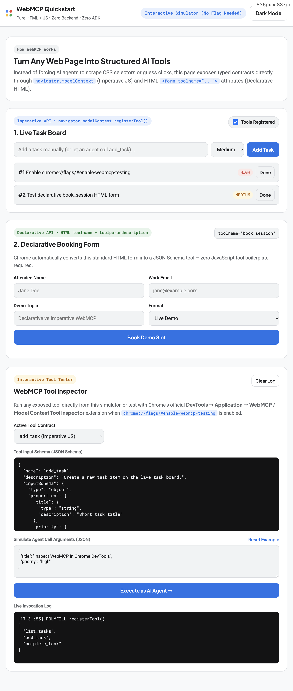
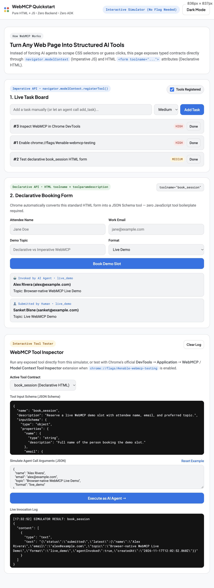
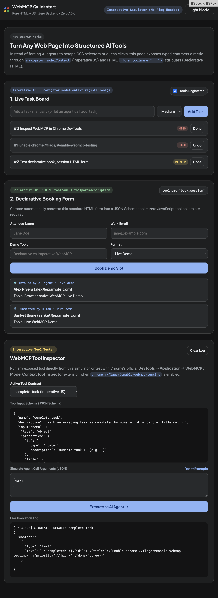
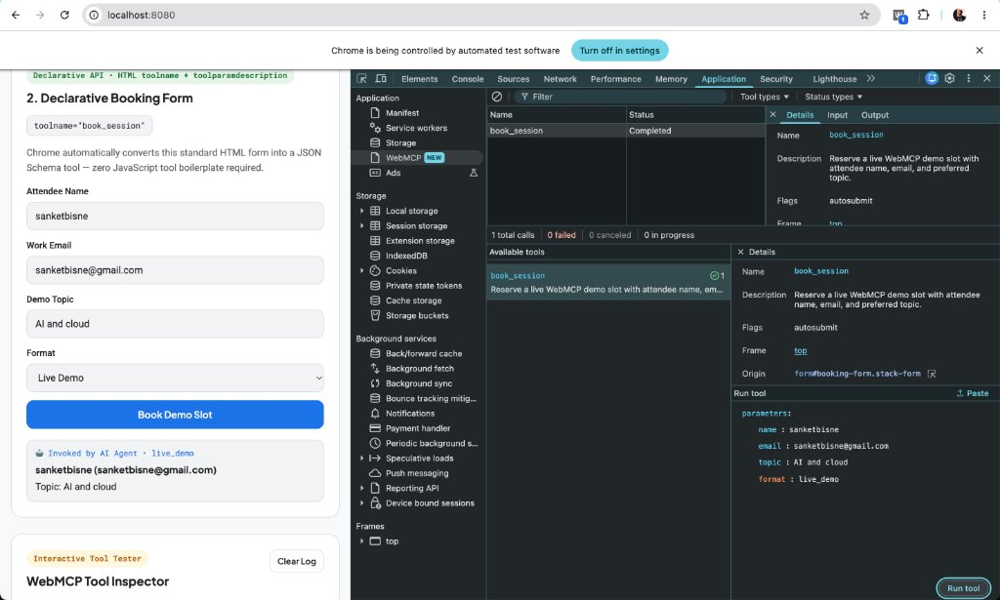
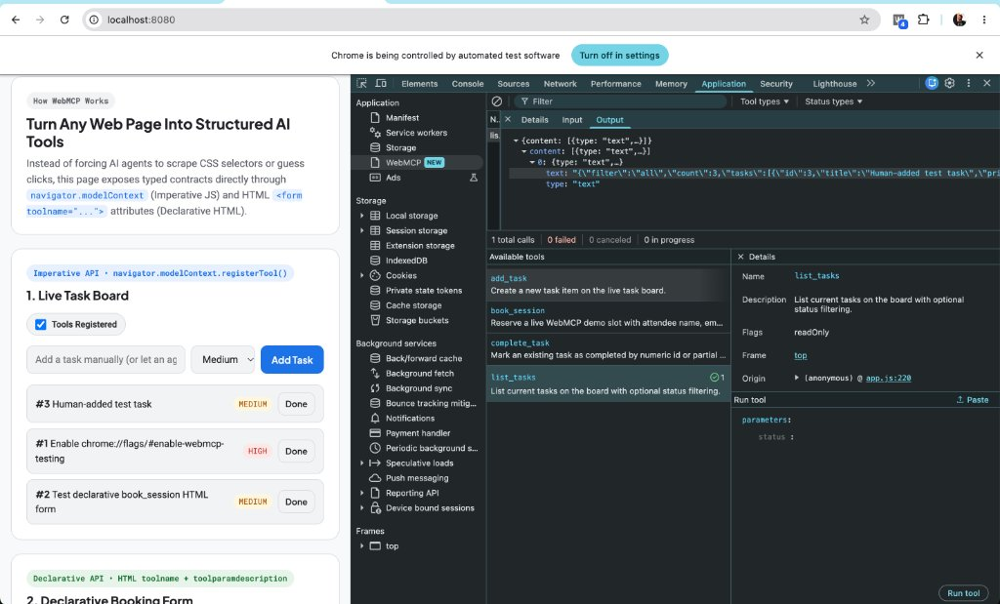
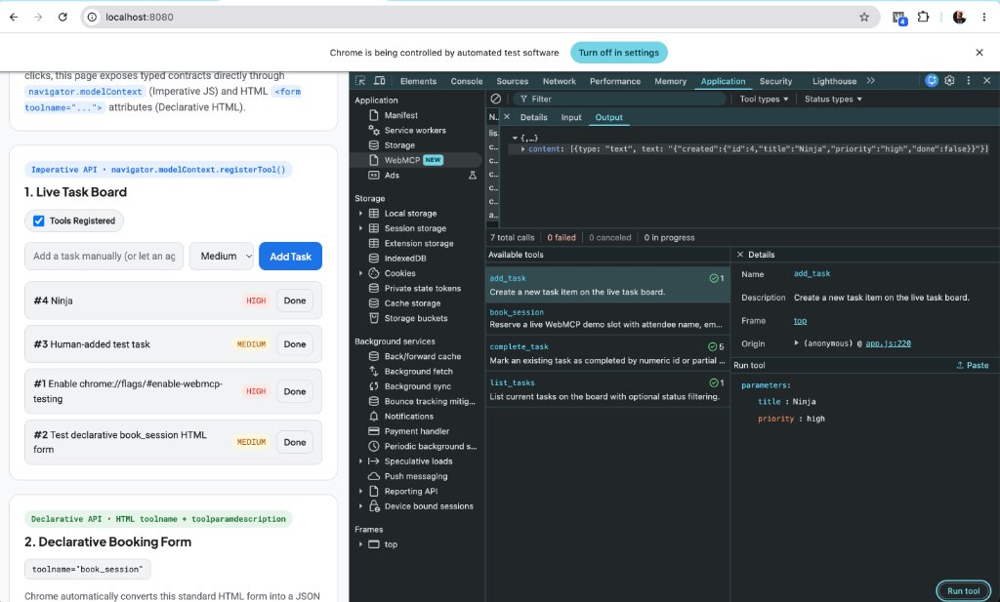
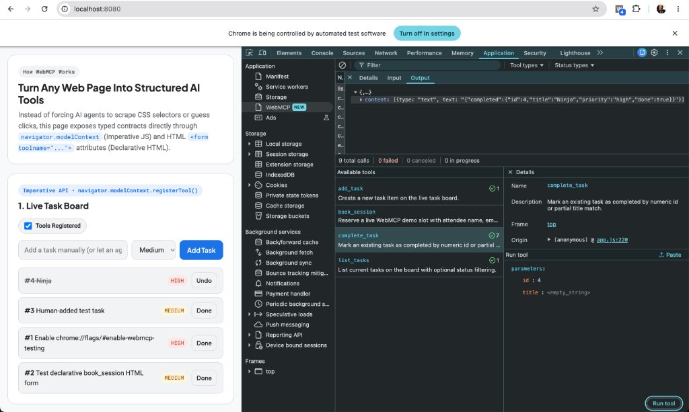

# WebMCP Quickstart — Pure Browser-Native AI Tools Demo

A zero-dependency, pure **HTML + CSS + Vanilla JavaScript** starter project showing **what WebMCP is** and **how to use & demo it in Chrome** — no backend, no build step, and no agent framework (ADK/LangGraph) required.

- **Live Demo (GitHub Pages):** https://sanketbisne.github.io/webmcp-quickstart/
- **Chrome WebMCP Documentation:** https://developer.chrome.com/docs/ai/webmcp



---

## What Is WebMCP (and Why Does It Matter)?

```mermaid
flowchart LR
    Agent["AI Agent / Chrome Extension"] -->|"1. Discover JSON Schemas"| Browser["Chrome WebMCP (document.modelContext)"]
    Browser -->|"Imperative JS API"| JS["modelContext.registerTool()"]
    Browser -->|"Declarative HTML API"| Form["<form toolname='book_session'>"]
    JS -->|"2. Typed Execution"| UI["Live Task Board UI"]
    Form -->|"3. agentInvoked + respondWith()"| Booking["Live Booking Confirmation"]
```

Traditionally, browser AI agents scrape messy DOM trees, guess CSS selectors, or rely on fragile screenshot clicks. **WebMCP (Web Model Context Protocol)** lets your web page directly publish typed tool contracts through Chrome (`document.modelContext` in Chrome 157+ / `navigator.modelContext` in earlier builds) and declarative HTML `<form>` attributes.



This repo demonstrates **both WebMCP APIs** side-by-side in ~250 lines of clean JavaScript:

| API Surface | Where It Lives | How Tools Are Exposed | Tools Included |
|---|---|---|---|
| **Imperative API** | [`app.js`](app.js) | `document.modelContext.registerTool({...})` (with `navigator.modelContext` fallback) + `AbortController` | `list_tasks`, `add_task`, `complete_task` |
| **Declarative API** | [`index.html`](index.html) | `<form toolname="..." tooldescription="..." toolautosubmit="true">` | `book_session` |

---

## Visual Walkthrough

### 1. Imperative vs Declarative Execution (AI Agent vs Human)

Both an AI agent (via WebMCP / Simulator) and a human user interact cleanly with the same live UI. Look at the **2. Declarative Booking Form** cards and **Live Invocation Log** below:



- **`👤 Submitted by Human`:** Filling **Book Demo Slot** manually fires a normal submit (`e.agentInvoked === false`) without triggering `respondWith()`.
- **`🤖 Invoked by AI Agent`:** Calling `book_session` populates `<form>` inputs automatically, sets `agentInvoked`, and returns structured JSON via `e.respondWith(...)`.

### 2. Task Completion, Dynamic Unmount & Dark Mode

Calling `complete_task` (`{ "id": 1 }`) updates task `#1` directly on the board, and unchecking **`Tools Registered`** triggers `AbortController` / `unregisterTool()` to unmount imperative tools in real time.



### 3. Native Chrome DevTools WebMCP Execution (All 4 Tools + Output)

Running `book_session` directly from **DevTools → Application → WebMCP → Run tool** executes the declarative `<form toolname="book_session">` contract natively inside Chrome, logs **`Completed`** (`0 failed`, `0 canceled`) in **Tool activity**, and renders **`🤖 Invoked by AI Agent`** on the page:



With **`chrome://flags/#enable-webmcp-testing`** enabled in Chrome 157+, all 4 tools (`add_task`, `book_session`, `complete_task`, and `list_tasks`) appear together in **Available tools** — and running `list_tasks` returns the live MCP JSON payload straight in DevTools **Output**:



Running **`add_task`** from **Run tool** (`title: "Ninja"`, `priority: "high"`) creates **`#4 Ninja` (`HIGH`)** live on the task board and returns the created task JSON in DevTools **Output** (`0 failed | 0 canceled`):



Running **`complete_task`** (`id: 4` or substring `title` fallback) marks **`#4 Ninja`** done (`Undo` button) and returns `{"completed":{"id":4,"title":"Ninja","priority":"high","done":true}}` in DevTools **Output**:



---

## Real-World Comparison: DOM Scraping vs. WebMCP

How does this simple quickstart compare to real-world production browser automation?

| Dimension | Traditional Browser Agent (DOM Scraping / Vision) | WebMCP (`navigator.modelContext` + `<form toolname>`) |
|---|---|---|
| **How it finds inputs** | Fragile CSS/XPath selectors (`#checkout > div:nth-child(3) > input`) or repeated screenshots + coordinate guesses | Typed **JSON Schema** published directly by the page (`name`, `email`, `topic`, `format`) |
| **When UI changes** | Any CSS class rename, A/B test, or responsive layout shift breaks the automation | Layout & styling can change freely as long as the tool contract stays intact |
| **Speed & token cost** | Multiple LLM vision turns (screenshot → find box → click → type → scroll → submit) | **Single deterministic tool call** with structured JSON response via `e.respondWith(...)` |
| **Auditability** | Page cannot tell a real user apart from a bot | `SubmitEvent.agentInvoked` explicitly flags agent actions (`🤖 Invoked by AI Agent` vs `👤 Submitted by Human`) |

### Mapping This Quickstart to Real-World Apps

| Quickstart Demo Tool | Real-World Production Equivalent | How It Scales |
|---|---|---|
| **`<form toolname="book_session">`** (Declarative HTML) | **E-Commerce Shipping Form / SaaS Support Ticket / Appointment Booking** | Add `toolname`, `tooldescription`, and `toolparamdescription` to an existing checkout or booking `<form>`—agents fill & validate all fields in one shot with zero custom JS glue |
| **`list_tasks` / `add_task` / `complete_task`** (Imperative JS) | **Product Catalog Search, Cart Mutation, Filtering Dashboards** (e.g., [NexusGear Storefront + Google ADK](https://github.com/sanketbisne/adk-webmcp-storefront)) | Register stateful SPA actions via `navigator.modelContext.registerTool()`, mount/unmount tools per route with `AbortController`, and enforce server/ADK safety guardrails before sensitive mutations like checkout |

---

## Step-by-Step Setup & Live Chrome Demo

### Step 1: Run Locally (or Open Live GitHub Pages)
WebMCP requires a secure context (`https://` or `http://localhost`):

```bash
git clone https://github.com/sanketbisne/webmcp-quickstart.git
cd webmcp-quickstart
python3 -m http.server 8080
```

Open **http://localhost:8080** (or open **https://sanketbisne.github.io/webmcp-quickstart/** directly).

> **Zero-Setup Mode:** The built-in **WebMCP Tool Inspector** on the right lets anyone test all 4 JSON Schemas and simulate agent calls immediately in any browser.

---

### Step 2: Enable Chrome's Native WebMCP Flag
To inspect and run tools natively inside Chrome's built-in DevTools & extensions:
1. Open **`chrome://flags/#enable-webmcp-testing`** in Google Chrome.
2. Set **WebMCP for testing** to **Enabled**.
3. Click **Relaunch**.
4. Reload the page — the top-right badge turns green (**`Native Chrome WebMCP Active`**).

---

### Step 3: Where to Click in Chrome DevTools
1. Open Chrome DevTools (`Cmd + Option + I` on macOS, or `F12` / `Ctrl + Shift + I` on Windows/Linux).
2. Click **Application** in the top DevTools bar *(click **`>>`** if hidden)*.
3. In the left sidebar under **Application**, scroll down and click **WebMCP**.
4. Under **Available tools** (bottom pane), click **`book_session`**, **`list_tasks`**, **`add_task`**, or **`complete_task`** to inspect the live JSON Schema and parameter descriptions Chrome discovered.
   *(Without `#enable-webmcp-testing`, Chrome still shows declarative `book_session`; with the flag enabled, all 4 tools appear.)*

---

### Step 4: Trigger Native `Tool activity` vs On-Page Simulator
- **On-page Simulator:** Selecting a tool in the page's **WebMCP Tool Inspector** and clicking **"Execute as AI Agent →"** runs a local JS simulation (logged inside **Live Invocation Log** on the page).
- **Native Chrome `Tool activity` Trace:** Open Google's **WebMCP - Model Context Tool Inspector** Chrome extension side panel, pick `book_session` or `add_task`, and click **Execute / Call Tool**. You will see the live call trace, input JSON, and `SubmitEvent.respondWith(...)` payload inside DevTools **Tool activity**, while the page renders **`🤖 Invoked by AI Agent`**.

---

### Step 5: Demo Dynamic Tool Registration (`AbortController`)
Toggle **`Tools Registered`** on and off inside **1. Live Task Board** while watching DevTools **Application → WebMCP → Available tools** — `list_tasks`, `add_task`, and `complete_task` disappear and reappear live without reloading the page.

---

## Code Cheat Sheet

**Imperative Tool (`app.js`):**
```javascript
const modelContext = document.modelContext || navigator.modelContext;

modelContext.registerTool({
  name: "add_task",
  description: "Create a new task item on the live task board.",
  inputSchema: {
    type: "object",
    properties: {
      title: { type: "string", description: "Short task title" },
      priority: { type: "string", enum: ["low", "medium", "high"] }
    },
    required: ["title"]
  },
  execute: async ({ title, priority }) => {
    // Update UI state and return MCP-compatible JSON response
    return { content: [{ type: "text", text: JSON.stringify({ title, priority }) }] };
  }
}, { signal: controller.signal });
```

**Declarative HTML Form (`index.html` + `app.js`):**
```html
<form id="booking-form" toolname="book_session" tooldescription="Reserve a live WebMCP demo slot..." toolautosubmit="true">
  <input type="text" name="name" autocomplete="name" required toolparamdescription="Full name of attendee">
  <!-- ... -->
</form>
```
```javascript
form.addEventListener("submit", (e) => {
  e.preventDefault();
  if (e.agentInvoked && typeof e.respondWith === "function") {
    e.respondWith(Promise.resolve(JSON.stringify({ status: "booked" })));
  }
});
```

---

## Project Structure

```text
webmcp-quickstart/
├── docs/assets/
│   ├── 01-overview-light.png
│   ├── 02-agent-execution-demo.png
│   ├── 03-dark-mode-complete-task.png
│   ├── 04-devtools-webmcp-completed.jpg
│   ├── 05-devtools-all-4-tools.jpg
│   ├── 06-devtools-add-task.jpg
│   └── 07-devtools-complete-task.jpg
├── index.html   # Task Board UI + Declarative <form toolname="book_session">
├── style.css    # Clean responsive Light/Dark styling
├── app.js       # Imperative registerTool() + Declarative submit hook + Simulator
└── README.md    # Visual walkthrough & live Chrome DevTools steps
```
